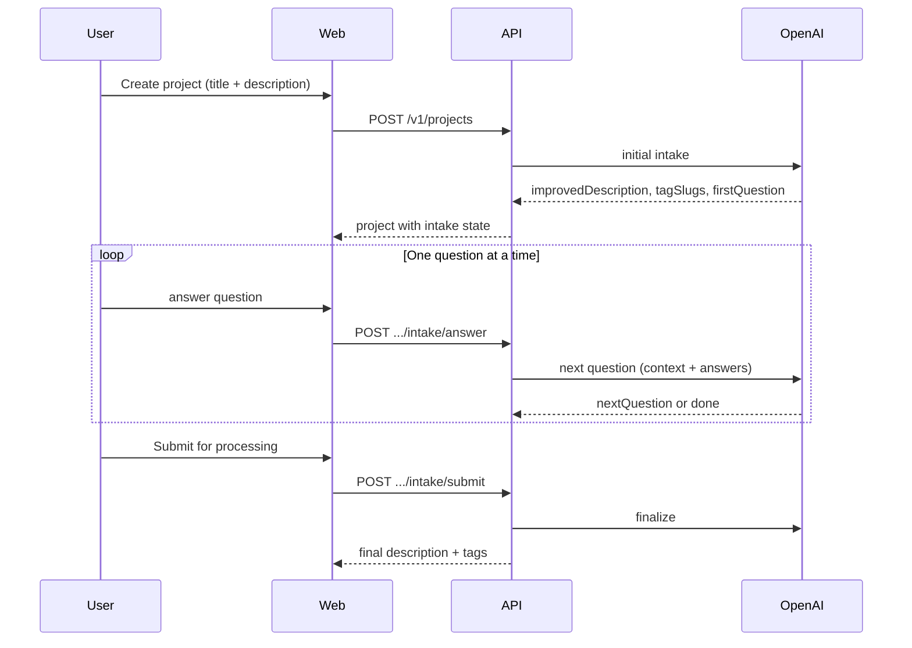

# AI intake (OpenAI)

Initial OpenAI integration for project scope intake: improved description, AI tags, and a one-question-at-a-time follow-up wizard.

## Flow



## Why one question at a time?

Answers can change what should be asked next (e.g. renovation scope → ask about area; new build → ask about land). A single static form cannot adapt. One question per step also keeps the UX focused.

## Configuration

| Variable | Required | Default |
|----------|----------|---------|
| `OPENAI_API_KEY` | no* | — |
| `OPENAI_MODEL` | no | `gpt-4o-mini` |

\* Without API key, a **rule-based fallback** runs (keyword tags + fixed question queue).

Set in `infra/.env` on EC2:

```env
OPENAI_API_KEY=sk-...
OPENAI_MODEL=gpt-4o-mini
```

Restart API after change.

## Question types

| Type | UI | Example |
|------|-----|---------|
| `single` | Radio | Property size band |
| `multi` | Checkbox | Trades involved |
| `text` | Textarea | Material notes |
| `info` | Continue button | Upload floor plans |

State is stored in `brief_json.ai.intake`.

## API

| Method | Path | Description |
|--------|------|-------------|
| POST | `/v1/projects` | Create + run initial AI intake |
| POST | `/v1/projects/:id/intake/answer` | Submit answer, get next question |
| POST | `/v1/projects/:id/intake/submit` | Finalize description and tags |

## UI

- **Create project:** no tag picker — tags assigned by AI on detail page
- **Project detail:** intake wizard until completed; tags shown in wizard then on page

## Scope gating of the wet-point question

The sanitary / wet-point count is the question clients most often see on projects
that have nothing to do with wet areas, so it is gated in three places that used
to disagree:

| Where | What is gated |
|-------|---------------|
| Intake prompt (`OpenAiIntakeService.buildingSystemsIntakeRules`) | Asked **only** when the scope names a bathroom, kitchen, sanitary ware or plumbing, or a whole dwelling is built/renovated. Never for a repair or replacement of a single element or fixture, a carport/shed/workshop, or an outdoor amenity |
| Intake queue | `shouldAskSanitaryPointsQuestions` → `wetPointsInScope` decides for the fallback queue and for model-authored questions (`SCOPE_RELEVANCE_RULES`), including paraphrases like "how many bathrooms and sinks?" |
| Estimate improvement questions | `normalizeResult` drops wet-point questions from the model unless `wetPointsInScope` says the scope needs them |

`wetPointsInScope(narrative, projectType)` (`intake-scope-heuristics.ts`) takes
plain text so the intake and the estimate apply the same rule:

- whole building ("whole house", "all rooms") → **yes**;
- bathroom/kitchen being renovated or built ("new kitchen", "bathroom
  renovation") → **yes**;
- new dwelling, even when only bedrooms and plot size are described → **yes**;
- extension or fit-out → only when a wet room or fixture is actually named;
- one element or one fixture (roof, windows, paint, tiles, one toilet, one tap)
  → **no**, however the sentence mentions a room;
- outdoor amenity / landscaping → **no**.

The intake decision uses the client's own words (title, description, uploaded
plan text), not `improvedDescription` or prior answers, so an AI rewrite that
invents a bathroom cannot pull the question in. If the client already stated a
count ("2 bathrooms"), the question is skipped.

