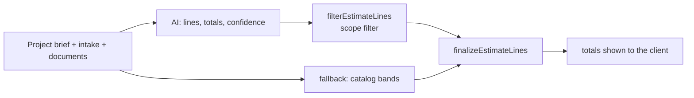

# Ballpark estimate (scope-scale rules)

The client-facing ballpark estimate is produced by `BallparkEstimateService`
(`apps/api/src/estimation/ballpark-estimate.service.ts`) and post-processed by
`estimate-scope.utils.ts`. Both the OpenAI path and the catalog fallback run the
same post-processing, so the rules below hold either way.

## Why the rules exist

Every band in `regional-catalog.ts` is an **installation** price: a residential
air-conditioner band is 18,000–45,000 THB per unit, `plumbing` is
8,000–28,000 THB per wet point, `structural` is 2,500–5,500 THB/sqm. That is the
right scale for building work and completely wrong for a repair visit.

Post-processing used to apply those bands (and the building area) to any scope,
so a cheap job came back expensive — a real report was an air-conditioner repair
estimated at **80,000–230,000 THB**.

## Scope-scale rules

| Rule | What it does | Where |
|------|--------------|-------|
| Service/repair detection | `projectType=repair` or service wording (`fix`, `service`, `clean`, `leak`, …) and **not** install/replace/renovate wording, and not whole-building wording | `isServiceOrRepairScope` |
| Repair bands | Unit prices are capped at 8–30 % of the installation band for the same trade (air-conditioner repair: 1,440–13,500 THB per unit). The model's lower value is kept | `repairBandForTrade`, `capServiceRepairLines` |
| Proportional quantity | On a repair, quantity is the number of units the client described (default 1); square-metre lines use the stated area or a 20 sqm patch, never the floor area | `capServiceRepairLines`, `UNSTATED_SMALL_SCOPE_AREA_SQM` |
| Minor-scope anchor | A job with no stated area and at most a few units may not exceed what *replacing* the items in scope would cost. One absolute check, independent of line shares | `capMinorScopeTotal` |
| No GFA rescale on repairs | The "qty=1 lump → whole floor area" rescue is skipped when the scope is a repair | `normalizeUnderpricedSqmShellLines({ skipGfaRescale })` |
| Small jobs keep their own electrical quantity | Electrical lines are no longer forced to the building area on a small job | `dedupeAndCapElectricalLines({ forceAreaQuantity })` |
| Industrial ventilation is gated | A residential narrative can no longer be repriced as industrial supply/exhaust ventilation (that turned an AC repair into 1,200–3,200 THB/sqm over the whole area); service/repair scope never is | `normalizeIndustrialHvacLines` |
| Building work never counts as "minor" | `new_build` / `extension` / `commercial_fitout` and any install/replace/renovate wording are building-scale by definition, even without a stated area | `describeScopeVolume` |

The prompt is told the same facts (`buildEstimateScopeRules` gets
`serviceRepair` and `minorScope`), so the model is guided before the
post-processing corrects it.

## Effect (measured on the compiled functions)

| Scenario | Before | After |
|----------|--------|-------|
| AC repair, house (reported case) | 79,750–231,000 | 1,440–4,200 |
| AC repair, warehouse with industrial wording | 360,000–960,000 | 1,440–13,500 |
| Service four air conditioners | 16,000–36,000 | 5,760–36,000 |
| Roof leak patch, no area given | 60,000–175,000 | 1,920–21,000 |
| Leaking toilet | 8,000–28,000 | 640–8,400 |
| AC fault misclassified as electrical | 110,000–325,000 | 3,520–39,000 |
| New house 150 sqm | 483,717–1,113,483 | unchanged |
| Replace the whole roof, 200 sqm | 240,000–700,000 | unchanged |
| Bathroom renovation, 12 sqm | 34,800–117,600 | unchanged |
| Office fit-out 300 sqm | 1,110,000–3,300,000 | unchanged |
| Warehouse ventilation (real facility) | 1,850,000–4,350,000 | unchanged |

## Who sees what

The line breakdown is rendered by `EstimateLinesEditor`, which used to be mounted
only for the owner — a guest saw the price range and nothing else, although the
API returns `lines` for guest projects too. The page now mounts it for everyone
in the workspace (`canManageWorkspace`) and passes `readOnly={!isOwner}`: the list
of works is visible, while removing a line, adding one and the AI refinement
questions stay owner-only (refinement spends AI budget, and both actions are
owner actions server-side as well).

The improvement questions themselves are free, so a guest sees them through
`EstimateQuestionsPreview`: a read-only list with the note that answering happens
after registration. Only the recalculation (`POST …/estimate/refine`) is
owner-only.
## When an estimate still looks wrong
Read the stored lines (`Estimate.linesJson`): `trade`, `quantity`, `unit`,
`unitPriceMin/Max`. The signatures are:

- `quantity` equal to the building area on a small job → a square-metre trade was
  used where the scope was not building work (check `describeScopeVolume`);
- description rewritten to "industrial ventilation" → the warehouse/facility
  pattern fire on a residential project (check `EXPLICIT_INDUSTRIAL_FACILITY_PATTERN`);
- a single `other` line at 40,000+ → the catch-all band was used; there is no
  repair band for an unclassified trade beyond the minor-scope anchor.

Lines added manually (`POST .../estimates/adjustments`, `priceCatalogEstimateLine`)
deliberately keep catalog installation bands: there the trade is an explicit
human choice.
